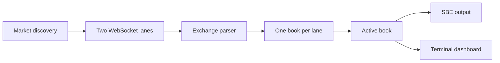

# Live order books

This collector follows live Kalshi or Polymarket order books and writes price-level updates and minute snapshots using the [Voluntas challenge](https://voluntas.io/engineering-challenge) SBE schema. It keeps two WebSocket copies of each market and can show coverage in a terminal dashboard.

## Design

Discovery adds new markets and removes closed ones. Each socket stamps a message when it is read; the parser converts it to YES-side prices and six-decimal quantities. The collector writes updates from one book, writes a full snapshot before switching books, and snapshots every ready book each minute. SBE goes to stdout or an automatic capture file when stdout is a terminal; the dashboard uses stderr, and Ctrl-C closes the sockets and flushes output.

## Findings

Measured on an Intel Core i7-1280P (14 cores, 20 threads), 31 GiB RAM, and Rust 1.95.0: one release-mode thread processed a synthetic Kalshi delta in **1,065 ns on average** (**0.94 million updates/s**) across JSON parsing, book mutation, and SBE encoding. Separately, parsing took 1,000 ns, a hot book update 18 ns, and SBE encoding 11 ns; JSON dominates this CPU path. The benchmark repeats one update one million times and does not measure network, TLS, task scheduling, snapshots, output writes, or tail latency.

During a broader Kalshi discovery run, one dashboard sample showed **56,100 discovered markets**, **49,978 ready** (89.1%), 6,122 pending (200 overdue), 74/76 sockets connected, nine resets, and 4,506 source switches. It emitted **13,967 deltas/s** and **1.08 MB of SBE/s** at that instant. These are loading-time figures, not sustained full-market capacity. Separately, a 610-second capture of 10 selected markets decoded completely into 23,050 deltas and 116 snapshots; replaying updates matched all 106 later snapshots, timestamps did not regress within a market, and SIGINT closed cleanly. Of 20,261 matched deltas in that small run, A arrived first 95.2% of the time; **B − A application receive time** was +0.010 ms at p05, +31.745 ms at p50, and +68.104 ms at p95. This compares the two connections, not absolute latency. Neither observation proves complete history or millisecond timing accuracy across the full market.

## Cargo aliases

Set `KALSHI_KEY_ID` and `KALSHI_PRIVATE_KEY_PATH` in `.env` before running Kalshi. `cargo rtp` uses the public Polymarket feed without credentials.

| Command | Purpose |
| --- | --- |
| `cargo rt` | Run Kalshi with the terminal dashboard |
| `cargo rtp` | Run Polymarket with the terminal dashboard |
| `cargo bt` | Run the CPU benchmark |
| `cargo cc` | Run Clippy on all targets with warnings denied |
| `cargo bb` | Build all targets and features in release mode |
| `cargo tk` | Run Kalshi tests |
| `cargo tp` | Run Polymarket tests |

## Conclusion

The collector implements live discovery, two socket copies and separate books per market, Kalshi and Polymarket adapters, SBE output, and a terminal dashboard. The selected-market run verified snapshots, deltas, source switching, and shutdown; the broader run shows substantial live throughput and the coverage backlog during discovery. Full-market coverage remains unverified: an earlier Kalshi scan timed out after finding 92,667 markets, and the newer scan had not finished at the observation above. A replacement snapshot cannot recreate missed intermediate updates, and timestamp accuracy under full load remains unmeasured.
